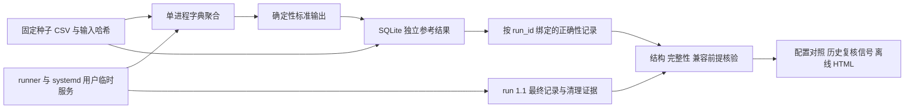

# 首版系统设计

日期：2026-11-17。当前源码入口及命令见 [完整流程](pipeline.md)，原始输出含义以 [run 1.1 数据协议](../contracts/data-contract.md) 为准。本文描述已实现机制；实测范围以 [验证记录](../validation/pipeline-validation.md) 为准。

## 需求与范围

目标用户是在固定 Linux 环境中验证数据处理任务资源行为的学生和开发者。固定输入、算法语义与正确性后，观察三档 CPU 上限下的耗时差异；同输入、同资源和兼容环境下，对历史版本给出可追溯的变化与复核信号。

首版采用单进程整数分组聚合，避免把并行度、网络或外部数据库的不确定性带入系统机制验证。它不是数据库服务、生产监控平台、自动调优器或根因诊断系统。CPU 配额控制时间上限，不保证实际算力，也不保证精确耗时倍数。

## 数据流与模块

`experiments/run_pipeline.py` 只编排步骤，不复制 runner 的状态机。A 执行器控制服务、采集、清理与最终记录；B 生成输入、实际聚合、独立校验；C 只离线读取最终记录，产生新派生结果，不重写原始数据或执行负载。

## 资源与生命周期

每次运行使用唯一 UUID 的临时 systemd 用户服务。服务设置 CPUAccounting、CPUQuota（null 档不设置）、KillMode=control-group、停止期限和 RuntimeMaxSec 看门狗。worker 在服务内读取 cgroup v2 控制与统计信息，启动负载，等待回收并记录测量；外部 runner 随后清理整个服务并核验卸载及组为空/删除，才写 result.json。

负载 wall 时间还包含现有 worker 计时点之后的服务内快照保存、文件打开、进程启动、等待/回收和末次采样，实际边界以数据协议为准。CPU 时间为已回收子进程 user+system 秒；cgroup 统计为采样差值，包含 worker 的区间开销。输入生成、SQLite 参考计算、后续报告生成不进入负载测量。系统接口与等待采样开销不能当作本队算法优化。

SIGINT/SIGTERM 终止后续调度并清理，保留 interrupted。worker 崩溃、启动失败、超时、指标缺失和清理失败分别保留。supervisor 硬终止由 worker 超时/看门狗限制寿命，再经同用户、同机器、同启动周期 recover 核验为 aborted；不能恢复为成功性能样本。该工具不是恶意程序沙箱，也不提供断电持久性或硬实时保证。

## 输入与算法语义

CSV 为整数 group,value。负载字典记录每组整数 count/sum，排序后输出紧凑 JSON；不输出路径、时间或随机字段。输入包含负值，用整数规避浮点加法次序差异；固定生成器、种子、规模和字节哈希使输入可复建。workload_version 是负载实际源码 SHA256 与 passes 参数，input_id 是生成器版本与输入 SHA256。

参考算法将同一输入导入 SQLite，执行 SQL GROUP BY/COUNT/SUM/ORDER BY，不调用字典聚合函数。每次 stdout 必须精确符合参考结果序列化；校验记录绑定 run_id 与实际 stdout SHA256，同时核对运行前后输入/负载哈希。此证据不提供恶意篡改防护或人工复核证明。

`--passes 2` 明确重复完整处理，用于保持功能输出一致的受控变慢样本。它不是实际线上版本事故；真实测量可以检验规则是否发出复核信号，不能据此推算普遍检出率。

## 分析的拒绝条件

C 首先按 schema 验证结果，核对配置中的计划数、各档预热/测量数、连续执行顺序与 experiment-status。未知版本/状态、非有限数、JSON 重复键、目录与 run_id 不一致、未最终化 pending、配置标识不一致均产生显式问题。

然后排除 synthetic、非 success、预热、配额/清理证据不足、指标不足、脏 Git、缺失/失败的正确性以及 stdout 哈希不匹配。配置对照固定实现、输入、环境与父级限制，允许本地配额不同；历史比较对每一条候选调用 A 的兼容接口，允许实现版本变化，但要求功能输出和其他前提兼容。未满足条件不能输出“正常”。

汇总提供样本数、每次耗时点、min/max、wall/CPU 中位数和可比时的倍数，逐条追溯 result.json 的路径与 SHA256。当前历史规则为至少各五条不同样本、中位数变化超过预设 15% 才提示复核；这是透明的探索性规则，不是统计显著性检验，也不是已验收的自动回归分类器。

## 原创增量、依赖与限制

本仓库新增的是执行生命周期、配额实证、版本化最终记录、正确性绑定、兼容门槛、拒绝与追溯流程及离线展示。CPU 隔离、资源统计、SQLite 聚合和 JSON schema 校验由系统/标准库/第三方提供，不能宣称这些底层机制为本队原创。代码没有复制成熟工具的实现；依赖与许可按项目来源记录核验。

运行时 runner 仅标准库；分析使用 jsonschema，其实际版本保存在每轮验证证据中。固定源码检出保留 schemas；目前支持从源码/可编辑安装运行，未验收独立 wheel 分发。SQLite 参考计算在内存中完成，默认两百万行只是初始流程实验；尚未做规模上界、内存峰值、磁盘冷缓存或跨机器性能泛化验收。

可见环境指纹无法覆盖温度、频率、宿主机负载或所有虚拟化约束。跨机器/系统数据分别保存，不能并入同一历史基线。原生命令正常场景对比与规则边界检查见扩展验证；非实现者复验、其他完整框架评估、普遍误报/漏报评估、最终视频/PPT及平台提交仍是后续独立验收项。
